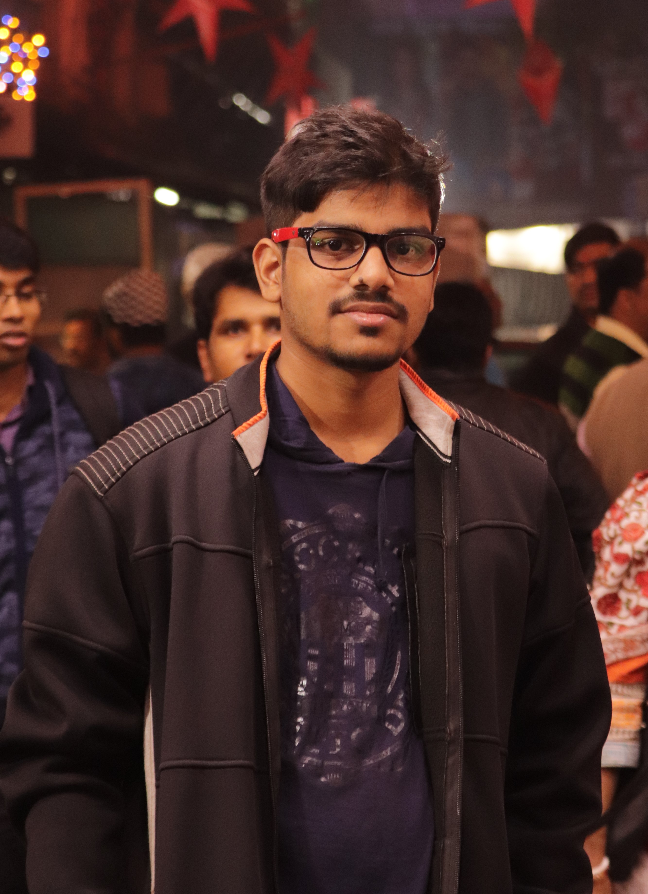
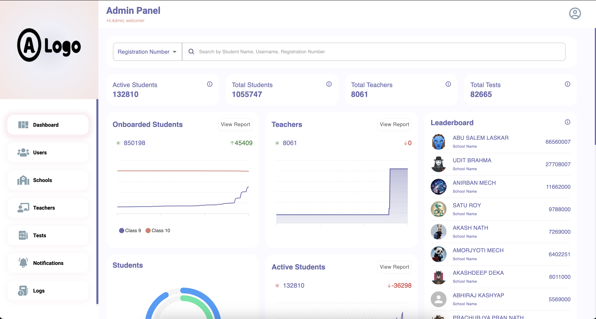
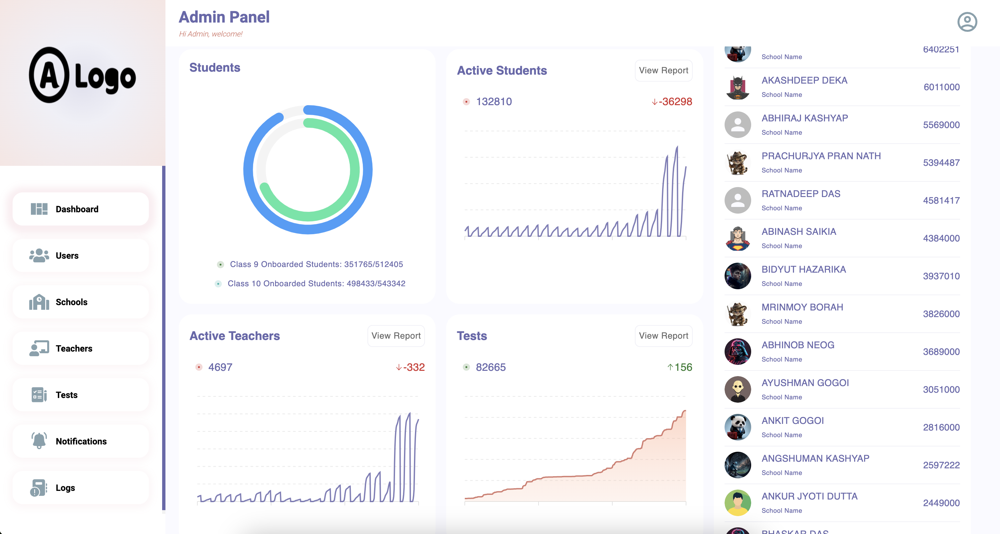
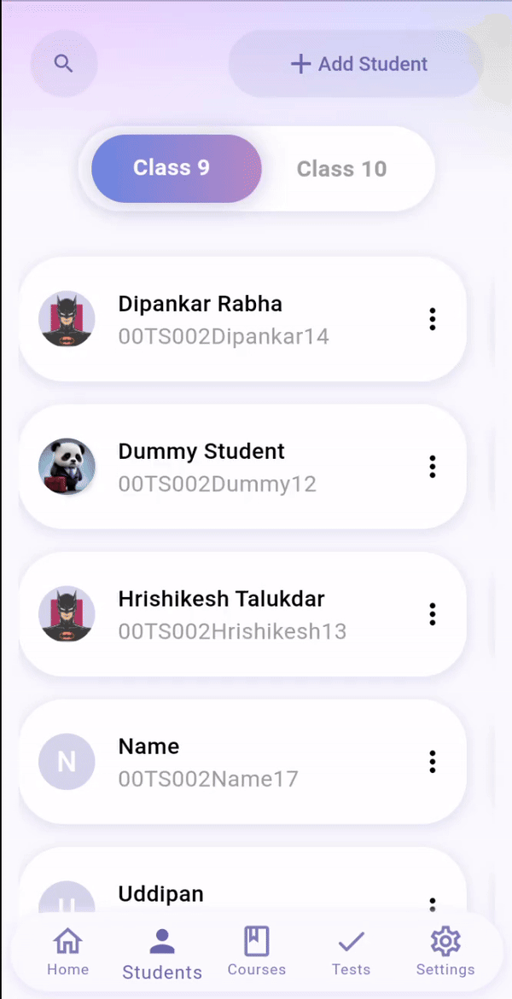
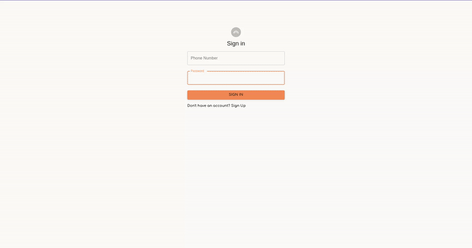
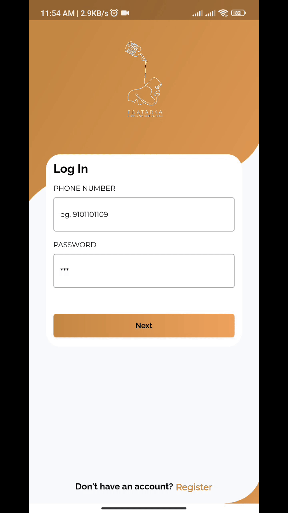
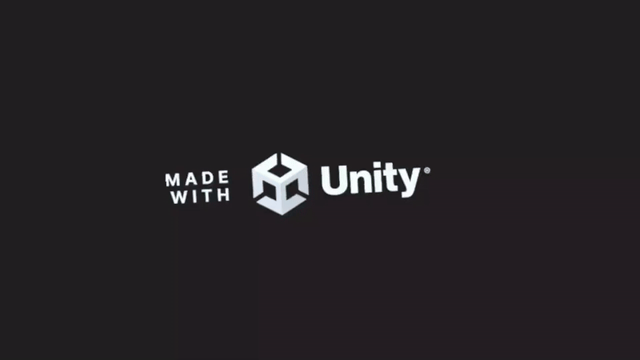
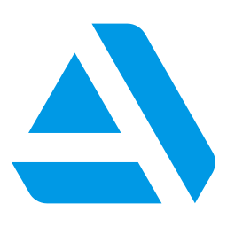

<h1>Hi , I am Uddipan Bhattacharyya </h1>
<!--
**uddipan32/uddipan32** is a ✨ _special_ ✨ repository because its `README.md` (this file) appears on your GitHub profile.
-->
 
 <!--  -->

<h3>CTO at Trusnetix Technologies | 3D Artist </h3>

<!--  -->

<h1>Hi, I'm Uddipan Bhattacharyya 👋</h1>

<h3>CTO at Trusnetix Technologies</h3>

I own the full lifecycle of cloud platforms serving **2M+ users**: architecture, deployment, CI/CD, monitoring, database operations, and incident response. I joined Trusnetix as its first engineering hire and grew from Software Engineering Intern to CTO.

  
  

---

## What I've delivered

- **99.95% uptime** across production environments
- **AWS bill cut by 60%** for a state government exam platform, with the same number of users
- **80% faster API response time** after re-architecting services and optimizing data access
- **15+ projects delivered** on time while leading Scrum teams
- **MongoDB Certified Database Administrator**, running replica sets, backup and recovery, disaster recovery, and upgrades in production

 
<b>⚡ GitHub Statistics</b>

 

<!--  -->

## What I work with

**Cloud and infrastructure**

**Containers and CI/CD**

-326CE5?style=flat-square&logo=kubernetes&logoColor=white)

**Monitoring and databases**

**Languages and frameworks**

## Key projects

### ASSEB Learning App
The official learning and exam platform of the Assam State School Education Board, used by lakhs of class 9 and 10 students and supporting practical examinations for **1.5M+ students**. I designed the scalable backend and database services and the infrastructure behind them, using auto-scaling, Redis caching, Terraform, Jenkins CI/CD, and Grafana and Prometheus monitoring, plus MongoDB backup and disaster recovery. Ranked **#4 in the Google Play Store Education category**.
[View on Google Play](https://play.google.com/store/apps/dev?id=8409135490366979922&hl=en_IN)

### CreatorXGrow
An all-in-one creator platform with Instagram lead automation, email campaigns, a website builder, and a course builder, with AI agent integrations built on Model Context Protocol (MCP). Infrastructure is provisioned with Terraform and monitored with Grafana and Prometheus. Also includes a video hook analyzer that combines machine-learning brain-response prediction with an LLM, running on Azure (AKS, VMs, Container Apps Jobs, and Azure OpenAI).
[creatorxg.com](https://www.creatorxg.com/)

### LMS Platform
A learning management system with 3D learning environments, an interactive REPL-based coding lab, and AI-powered video subtitle dubbing. Deployed on AWS (ECS, ECR, EC2) with Terraform and monitored with Grafana and Prometheus.
[View project](https://www.trusnetix.com/our-works/rex-academy)

### Roodimeds
A hyper-local medicine delivery platform with three apps for consumers, delivery partners, and pharmacies, featuring real-time order and delivery tracking, with MongoDB aggregation tuning on Atlas.
[View project](https://www.trusnetix.com/our-works/roodimeds)

### BigMind
An office management platform for CA and accounting firms, with a dashboard to track work progress, document records, and employee attendance.
[View project](https://www.trusnetix.com/our-works/bigmind)

<b>Screenshots</b>

 

**Admin panel:** a dashboard with real-time statistics for 1 million active users.

**Teacher app:** an easy-to-use app for teachers to manage their students and classes.

**Learning platform:** course management and analytics for admins, and a student app with progress tracking and collaboration.

**Virtual reality (Meta Quest):** an interactive 3D experience built for Meta Quest.

## Beyond IT
### My Animation Career

I also build games and 3D experiences with Unity, Godot, Three.js, and Blender, and share 3D work on [ArtStation](https://uddipan_bhatta7.artstation.com).

My creative work includes **3D modelling for more than 30 music videos**, including **3 music videos for Bollywood singer Papon**, **VFX for 2 Assamese web series**, and **VFX for 2 feature films and 2 web series**.

You can explore more of my creative work on **[Youtube Playlist](https://youtube.com/playlist?list=PLVS5-BWu8Vm8FVbmNU9RRo0zTAC9m7HqY)**,  **[IMDb](https://www.imdb.com/name/nm16424935/)**

## Certifications

- MongoDB Certified Database Administrator (2026)
- Google Generative AI Leader (2026)
- Fundamentals of Agents (2026)

---

  <a href="https://www.linkedin.com/in/uddipanbhattacharyya/">LinkedIn</a> |
  <a href="mailto:uddipanbhatta@gmail.com">Email</a> |
  <a href="https://www.hackerrank.com/uddipan_bhatta7">HackerRank</a>

##
<!-- 💻 Skilled in Python(Programming Language), JS, Dart, C/C++, PHP, Javascript, C# .\
🔭 I’m currently working on a project using javascript three.js. \
📱 Hobby - 3d Modelling using Blender 3d. \
-->

<!---->

 
<b>Contact:</b>

 

<!--

<b>⚡ Recent GitHub Activity</b>

   
   
   
  -->
  

